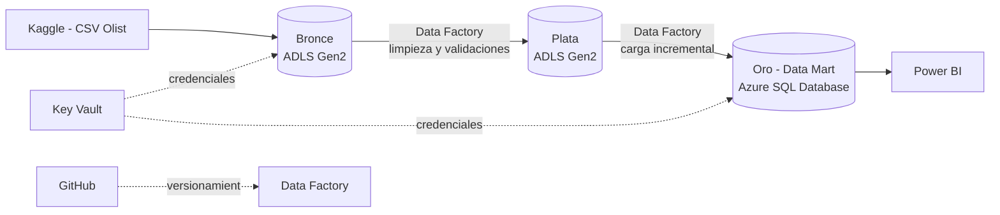

# Data Mart de Ventas E-commerce en Azure (Olist)

Proyecto end-to-end de ingeniería de datos: desde los CSV crudos hasta un **data mart en modelo estrella** consumido por Power BI, construido sobre Azure con **arquitectura medallón** (bronce, plata y oro), **carga incremental**, **validaciones de calidad**, **seguridad** y **control de versiones**.

> Estado: 🚧 en construcción

## Arquitectura



## Stack

| Capa | Servicio |
|---|---|
| Almacenamiento (bronce y plata) | Azure Storage con espacio de nombres jerárquico (Data Lake Gen2) |
| Orquestación y ETL | Azure Data Factory (pipelines y flujos de datos) |
| Data Mart (oro) | Azure SQL Database |
| Seguridad | Azure Key Vault, roles con mínimo privilegio, enmascaramiento de datos |
| Visualización | Power BI |
| Control de versiones | Git y GitHub (integración nativa con Data Factory) |

## Modelo estrella

- **Hechos:** `fact_ventas` (grano: un ítem de un pedido)
- **Dimensiones:** `dim_cliente`, `dim_producto`, `dim_vendedor`, `dim_fecha`

_(Diagrama del modelo: pendiente)_

## Calidad de datos (capa plata)

- [ ] Control de duplicados por clave
- [ ] Validación de esquema y tipos
- [ ] Validación de fechas (nulas, futuras, orden lógico compra → envío → entrega)
- [ ] Integridad referencial (cada ítem con pedido, producto y vendedor existentes)
- [ ] Conteos y conciliación de montos entre capas

## Seguridad

- [ ] Credenciales en Key Vault (ninguna contraseña en pipelines ni en el repositorio)
- [ ] Usuario de solo lectura para Power BI (`GRANT SELECT`)
- [ ] Enmascaramiento dinámico de datos sensibles

## Estructura del repositorio

```
sql/silver/   Scripts de validación
sql/gold/     DDL del modelo estrella y procedimientos de carga
adf/          Pipelines de Data Factory (sincronizados con Git)
powerbi/      Archivo del dashboard
docs/         Diagramas y capturas
scripts/      Utilidades (carga inicial a bronce)
```

## Avance

- [ ] Paso 1: datos y repositorio
- [ ] Paso 2: capa bronce
- [ ] Paso 3: seguridad base (Key Vault)
- [ ] Paso 4: capa plata
- [ ] Paso 5: modelo estrella
- [ ] Paso 6: capa oro con carga incremental
- [ ] Paso 7: permisos y enmascaramiento
- [ ] Paso 8: dashboard en Power BI
- [ ] Paso 9: documentación final

## Datos

[Brazilian E-Commerce Public Dataset by Olist](https://www.kaggle.com/datasets/olistbr/brazilian-ecommerce) (Kaggle, licencia CC BY-NC-SA 4.0). Los CSV no se incluyen en el repositorio.

## Autor

Álvaro Fabricio Núñez Rivas · [LinkedIn](https://linkedin.com/in/fabricionunrivas) · [GitHub](https://github.com/Fabricio-UNI)
