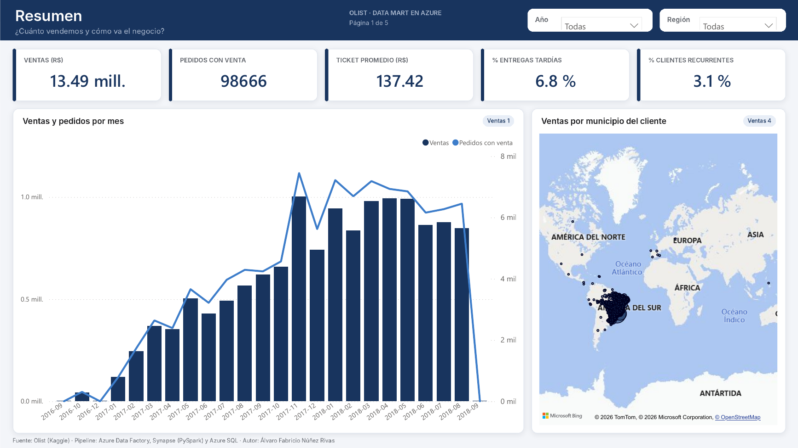
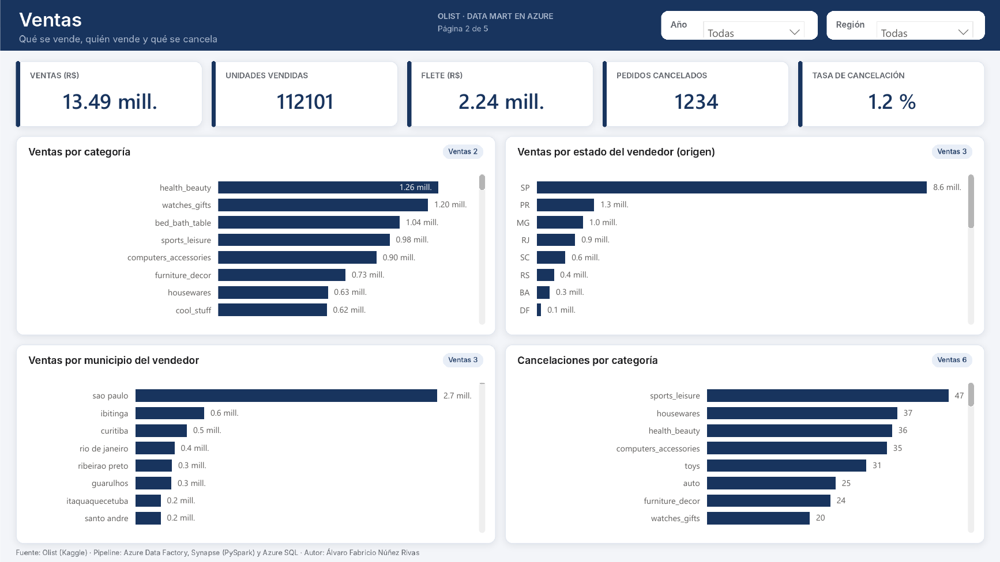
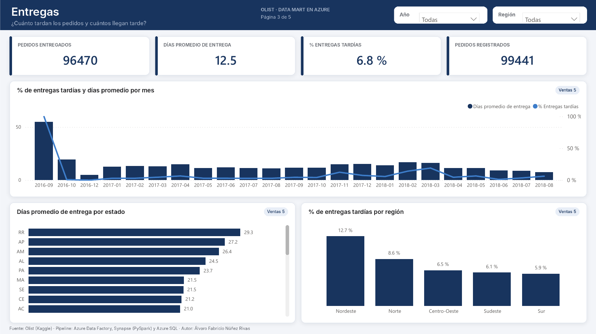
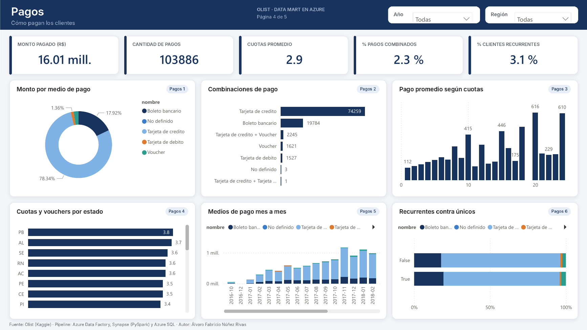
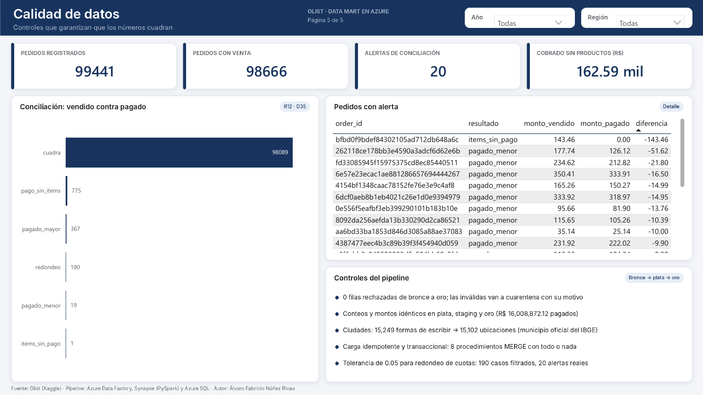
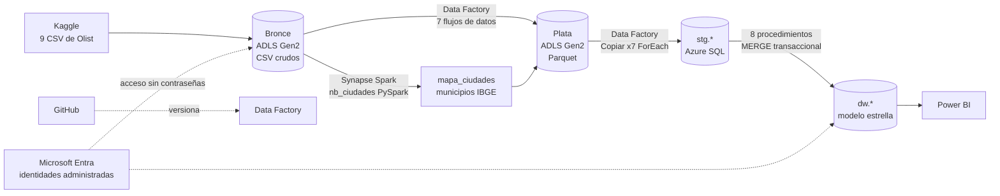
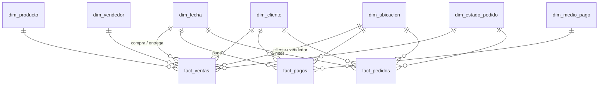

# Data Mart de Ventas E-commerce en Azure (Olist)

Proyecto de ingeniería de datos de punta a punta: lleva el dataset público de **Olist** (e-commerce brasileño: 9 archivos CSV, **99,441 pedidos**) desde los archivos crudos hasta un **modelo estrella en Azure SQL**, con **arquitectura medallón** (bronce → plata → oro), validaciones de calidad verificadas capa por capa, seguridad sin contraseñas y todo versionado en Git.

> **Estado (27/11/2026):** terminado. Bronce, plata, oro, orquestación diaria y tablero de Power BI de 5 páginas, verificados capa por capa.

## Resultados en números

| Qué | Resultado |
|---|---|
| Volumen | 99,441 pedidos · 112,650 ítems · 103,886 pagos · 32,951 productos · 3,095 vendedores · 96,096 clientes (personas) |
| Calidad | 0 filas rechazadas; conteos y montos idénticos entre plata, staging y oro (16,008,872.12 pagados; 13,591,643.70 en precio; 2,251,909.54 en flete) |
| Ciudades | 15,249 formas distintas de escribir (ciudad, estado, CP) → **15,102 ubicaciones** a nivel de municipio oficial del IBGE; São Paulo, escrita de 9 formas, unificada; estado corregido en 34 vendedores |
| Conciliación | 98.6% de los pedidos: lo pagado cuadra exacto con lo vendido; 20 alertas reales tras filtrar el redondeo de cuotas |
| Carga | Idempotente (ejecutarla dos veces no duplica nada) y transaccional (si falla, el modelo no queda a medias). Plata → oro en ~1 minuto |

## Tablero de Power BI

5 páginas sobre el modelo estrella (modo Importar, conexión con un usuario de solo lectura). Responde las 12 preguntas de negocio de [`docs/decisiones_modelo.md`](docs/decisiones_modelo.md). Archivo: [`powerbi/olist_datamart.pbix`](powerbi/olist_datamart.pbix).



| Ventas | Entregas |
|---|---|
|  |  |
| **Pagos** | **Calidad de datos** |
|  |  |

Medidas DAX en una tabla `_Medidas` con carpetas (ventas, entregas, pagos, calidad). Reglas que respetan: las ventas excluyen cancelados; los pedidos se cuentan con `DISTINCTCOUNT`; el % de entregas tardías se mide por pedido (no por ítem); la fecha de compra es la relación activa en todos los hechos, y la de entrega se activa con `USERELATIONSHIP` solo donde hace falta.

## Arquitectura



| Pipeline (ADF) | Qué hace |
|---|---|
| `pl_olist_completo` | Maestro: ejecuta los dos de abajo en cadena. Desencadenador diario (`tr_diario_2am`) |
| `pl_bronze_a_silver` | 5 flujos de datos independientes + el notebook de ciudades → flujos de `sellers` y `customers` |
| `pl_silver_a_oro` | ForEach parametrizado que copia 7 tablas de plata a `stg` (en paralelo) → procedimiento maestro `dw.usp_cargar_oro` |

## Stack

| Capa | Servicio |
|---|---|
| Lake (bronce y plata) | Azure Data Lake Storage Gen2 |
| Orquestación y limpieza | Azure Data Factory: pipelines, flujos de datos de asignación, datasets parametrizados, integración con Git |
| Estandarización de ciudades | Azure Synapse Analytics: pool de Spark (PySpark) |
| Data mart (oro) | Azure SQL Database (serverless, oferta gratuita): T-SQL, MERGE, procedimientos almacenados, vistas |
| Seguridad | Microsoft Entra (identidades administradas, solo autenticación Entra), RBAC, Key Vault, mínimo privilegio |
| Visualización | Power BI: modelo estrella, medidas DAX, 5 páginas |
| Control de versiones | Git y GitHub |

## Modelo estrella (oro)



| Tabla | Grano (1 fila =) | Contenido |
|---|---|---|
| `fact_ventas` | 1 ítem de un pedido (112,650) | Precio y flete |
| `fact_pagos` | 1 pago (103,886) | Monto, cuotas, medio de pago |
| `fact_pedidos` | 1 pedido (99,441), *snapshot* acumulativo | 5 fechas de hitos, días de entrega y de retraso, entrega tardía, monto pagado |
| `dim_cliente` | 1 persona (`customer_unique_id`) | Primera compra, n.º de pedidos, recurrente |
| `dim_ubicacion` | (CP, municipio, estado) | Municipio y código IBGE, estado, región |
| `dim_producto`, `dim_vendedor` | 1 producto / 1 vendedor | Categoría (pt/en), medidas / municipio, estado, región |
| `dim_fecha`, `dim_medio_pago`, `dim_estado_pedido` | Calendario generado y catálogos fijos | Nombres en español y grupos |

Técnicas: llaves sustitutas, miembro desconocido (−1), dimensiones de rol (fecha ×5, ubicación del cliente y del vendedor), dimensión degenerada (`order_id`), SCD tipo 1 y **cada medida en su grano** (los tiempos de entrega viven en `fact_pedidos` para no ponderar por cantidad de ítems).

## Calidad de datos

- **Plata (Data Factory):** tipos declarados, limpieza de textos, validación de claves y reglas de negocio, deduplicación por clave y **cuarentena**: las filas inválidas van a `rechazados/` con su motivo, no se pierden.
- **Verificación capa por capa:** consultas en `sql/silver/` (Synapse serverless) y pruebas de cada procedimiento contra staging; cada número de la tabla de resultados se comprobó por dos caminos.
- **Ciudades (PySpark):** normalización (minúsculas, tildes con `unicodedata`, estado pegado al nombre), comparación con la **lista oficial de municipios y distritos del IBGE**, corrección de tipeos con **distancia de Levenshtein** solo dentro del mismo estado y con reglas estrictas, y una **tabla de corrección manual** revisada a mano (`referencia/correccion_ciudades.csv`). Lo que no se pudo resolver con evidencia (6 localidades, 0.1%) se marca, no se adivina.
- **Conciliación (`dw.v_conciliacion_pedidos`):** lo vendido contra lo pagado por pedido, con una tolerancia de 0.05 para el redondeo de cuotas, elegida mirando la distribución real de las diferencias.

### Tres errores que los controles atraparon

1. **Agregado sin agrupar:** el flujo de `order_items` devolvía 1 fila en vez de 112,650. Se detectó comparando los conteos de bronce contra plata.
2. **Escala del decimal:** `payments` salió con escala 0 (100 pagos en cero en vez de 9). Se detectó comparando el texto de bronce con plata y se corrigió a `decimal(10,2)`.
3. **Falsos positivos del *fuzzy*:** Levenshtein ≤2 unía ciudades distintas con nombres cortos. Se endurecieron las reglas (≤1 para nombres cortos, candidato único) y lo dudoso pasó a revisión humana.

## Seguridad

- **Cero contraseñas:** Data Factory, Synapse y Azure SQL se autentican con **identidades administradas** de Microsoft Entra; Azure SQL solo acepta autenticación Entra.
- **Mínimo privilegio:** Data Factory puede leer y vaciar `stg`, pero sobre el modelo `dw` **solo puede ejecutar procedimientos** (escribe a través de ellos, nunca directo). En Synapse tiene solo *Compute Operator* y *Artifact User*. Para Power BI hay un rol de solo lectura sobre `dw` (`sql/gold/08_lectura_power_bi.sql`).

## Hallazgos de negocio

- Solo el **3%** de los clientes vuelve a comprar (2,913 de 96,096).
- El **6.8%** de las entregas llega tarde; la entrega toma **12.5 días** en promedio.
- **775 pedidos sin productos** (no disponibles o cancelados) se cobraron: R$ 162,591.95.
- Medios de pago: tarjeta de crédito 74%, boleto 19%, voucher 5.6%, débito 1.5%.

## Decisiones de diseño

Las 35 decisiones, con sus alternativas descartadas y el porqué, están en [`docs/decisiones_modelo.md`](docs/decisiones_modelo.md). El perfilamiento de los datos de origen está en [`docs/perfilamiento.md`](docs/perfilamiento.md). Algunas:

- **No se prorratean pagos entre productos:** el dato no dice a qué producto se aplicó cada pago; repartirlo sería inventar.
- **Cliente = persona** (`customer_unique_id`), no `customer_id` (que cambia en cada pedido): si no, nadie sería cliente recurrente.
- **"Pedidos con venta" (98,666) contra pedidos registrados (99,441):** 775 pedidos no tienen ítems; no se inventan filas en `fact_ventas`, y `fact_pedidos` conserva todos.
- **Staging + MERGE en procedimientos** (frente a flujos directos a oro o Synapse serverless): más barato, transaccional y con mínimo privilegio.

## Estructura del repositorio

```
adf/          Pipelines, flujos de datos, datasets y servicios vinculados (exportados por la integración Git de ADF)
notebooks/    nb_ciudades.ipynb: estandarización de ciudades en PySpark
referencia/   Lista del IBGE y tablas de corrección versionadas (ciudades y traducciones)
sql/
  perfilamiento/  Perfilamiento de los CSV (Synapse serverless)
  silver/         Verificación de cada tabla de plata
  gold/           01 esquemas y seguridad · 02 staging · 03 dimensiones · 04 dim_fecha
                  05 hechos · 06 procedimientos MERGE · 07 vistas · 08 lectura para Power BI
docs/         Decisiones de diseño, perfilamiento y capturas
powerbi/      Tablero (.pbix), tema y fondos de página (diseno/)
```

## Cómo reproducirlo

1. Crear en Azure: cuenta de almacenamiento con espacio de nombres jerárquico (contenedores `bronze` y `silver`), Data Factory conectado a este repositorio, área de trabajo de Synapse con un pool de Spark y una base Azure SQL con autenticación solo Entra.
2. Subir los CSV de Olist a `bronze/olist/` y los archivos de `referencia/` a sus carpetas.
3. Dar a las identidades administradas los roles indicados en la sección de seguridad.
4. Ejecutar en orden los scripts `sql/gold/01` a `08` en la base de datos.
5. Ejecutar `pl_olist_completo` en Data Factory.
