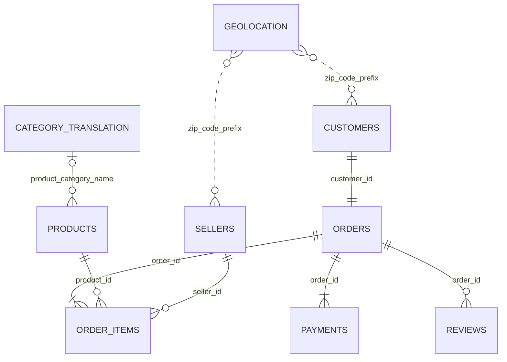
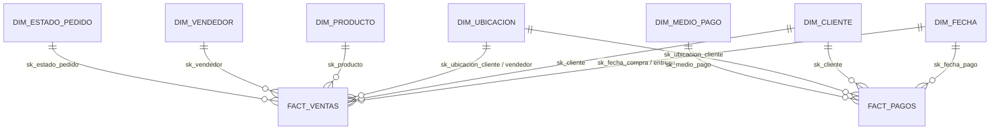

# Decisiones del modelo dimensional — Data Mart Olist

> Documento de diseño de la capa **oro** (data mart en Azure SQL Database).
> Metodología: Kimball (proceso de negocio → grano → dimensiones → hechos).
> Última actualización: 2026-11-18.

---

## 1. Contexto

- **Fuente:** [Brazilian E-Commerce Public Dataset by Olist](https://www.kaggle.com/datasets/olistbr/brazilian-ecommerce) — 9 CSV exportados del sistema transaccional (OLTP) de Olist, ~100 mil pedidos entre 2016 y 2018.
- **Objetivo:** un data mart en **modelo estrella** que responda preguntas de ventas y pagos desde Power BI.
- **Arquitectura:** bronce (CSV crudos, ADLS Gen2) → plata (datos limpios y validados, Parquet) → **oro (este modelo, Azure SQL Database)** → Power BI.

---

## 2. Preguntas de negocio

El modelo se diseña a partir de estas preguntas, no a partir de las tablas de origen.

### Ventas
1. ¿Cuánto vendemos por mes (en unidades, pedidos y monto)?
2. ¿Qué categorías de producto venden más?
3. ¿Qué vendedores venden más y desde qué estados despachan?
4. ¿A qué estados y ciudades se vende más?
5. ¿Cuánto tardan las entregas y cuántas llegan tarde respecto a la fecha prometida?
6. ¿Cuántos pedidos se cancelan y de qué categorías?

### Pagos
1. ¿Qué medio de pago se usa más y cuánto dinero mueve cada uno?
2. ¿Qué combinaciones de pago son más comunes (por ejemplo, tarjeta + voucher)?
3. ¿En cuántas cuotas paga la gente y cómo cambia según el monto?
4. ¿En qué estados y ciudades se usan más los vouchers y las cuotas?
5. ¿Cómo evolucionan los medios de pago mes a mes?
6. ¿Los clientes que repiten compra pagan distinto que los que compran una sola vez?

---

## 3. Inventario de fuentes

Conteos aproximados según Kaggle; **se confirman en el perfilamiento**.

| # | Tabla de origen | Grano (1 fila =) | Llave | Filas aprox. | Uso en el modelo |
|---|---|---|---|---|---|
| 1 | `olist_orders_dataset` | 1 pedido | `order_id` | 99,441 | Fechas, estado y cliente de cada hecho |
| 2 | `olist_order_items_dataset` | 1 unidad de producto en un pedido | `order_id` + `order_item_id` | 112,650 | **Grano de `fact_ventas`** |
| 3 | `olist_order_payments_dataset` | 1 pago de un pedido | `order_id` + `payment_sequential` | 103,886 | **Grano de `fact_pagos`** |
| 4 | `olist_order_reviews_dataset` | 1 reseña | ninguna confiable | 99,224 | Fuera de alcance (v1) |
| 5 | `olist_customers_dataset` | 1 `customer_id` (uno por pedido) | `customer_id` | 99,441 | `dim_cliente`, `dim_ubicacion` |
| 6 | `olist_products_dataset` | 1 producto | `product_id` | 32,951 | `dim_producto` |
| 7 | `olist_sellers_dataset` | 1 vendedor | `seller_id` | 3,095 | `dim_vendedor`, `dim_ubicacion` |
| 8 | `product_category_name_translation` | 1 categoría | `product_category_name` | 71 | Enriquece `dim_producto` |
| 9 | `olist_geolocation_dataset` | 1 punto de un código postal | ninguna | 1,000,163 | Fuera de alcance (v1) |

### Especificación de cada CSV (diccionario de datos de origen)

Tipos lógicos (los CSV no traen tipos: todo llega como texto y se convierte en plata).
PK = llave primaria · FK = llave foránea (apunta a otra tabla).

#### 1. `olist_orders_dataset.csv` — pedidos
Grano: 1 fila = 1 pedido · Llave: `order_id` · Vista de perfilamiento: `v_orders`

| Columna | Tipo | Llave | Qué es |
|---|---|---|---|
| `order_id` | texto (32) | PK | Identificador del pedido |
| `customer_id` | texto (32) | FK → customers | Cliente **de este pedido** (uno nuevo por pedido, ver hallazgo 4) |
| `order_status` | texto | | Estado: delivered, shipped, canceled, unavailable, invoiced, processing, created, approved |
| `order_purchase_timestamp` | fecha y hora | | Cuándo se hizo la compra |
| `order_approved_at` | fecha y hora | | Cuándo se aprobó el pago |
| `order_delivered_carrier_date` | fecha y hora | | Cuándo se entregó a la transportista |
| `order_delivered_customer_date` | fecha y hora | | Cuándo llegó al cliente |
| `order_estimated_delivery_date` | fecha | | Fecha de entrega prometida al cliente |

#### 2. `olist_order_items_dataset.csv` — productos de cada pedido
Grano: 1 fila = 1 unidad de producto en un pedido · Llave: `order_id` + `order_item_id` · Vista: `v_order_items`

| Columna | Tipo | Llave | Qué es |
|---|---|---|---|
| `order_id` | texto (32) | PK (1/2), FK → orders | Pedido al que pertenece el ítem |
| `order_item_id` | entero | PK (2/2) | Correlativo del ítem dentro del pedido (1, 2, 3…). No hay columna de cantidad: 3 unidades = 3 filas |
| `product_id` | texto (32) | FK → products | Producto vendido |
| `seller_id` | texto (32) | FK → sellers | Vendedor que lo vendió |
| `shipping_limit_date` | fecha y hora | | Fecha límite para que el vendedor despache |
| `price` | decimal | | Precio del ítem |
| `freight_value` | decimal | | Costo del flete de ese ítem |

#### 3. `olist_order_payments_dataset.csv` — pagos
Grano: 1 fila = 1 pago de un pedido · Llave: `order_id` + `payment_sequential` · Vista: `v_payments`

| Columna | Tipo | Llave | Qué es |
|---|---|---|---|
| `order_id` | texto (32) | PK (1/2), FK → orders | Pedido pagado |
| `payment_sequential` | entero | PK (2/2) | Número del pago dentro del pedido (1, 2…). Varias filas = varios medios de pago (ej. voucher + tarjeta) |
| `payment_type` | texto | | Medio: credit_card, boleto, voucher, debit_card, not_defined |
| `payment_installments` | entero | | Número de cuotas (10 cuotas = 1 sola fila) |
| `payment_value` | decimal | | Monto pagado en ese pago |

#### 4. `olist_order_reviews_dataset.csv` — reseñas (fuera de alcance v1)
Grano: 1 fila = 1 reseña · Llave: ninguna confiable (`review_id` se repite)

| Columna | Tipo | Llave | Qué es |
|---|---|---|---|
| `review_id` | texto (32) | | Identificador de la reseña (no es único) |
| `order_id` | texto (32) | FK → orders | Pedido reseñado |
| `review_score` | entero | | Calificación de 1 a 5 |
| `review_comment_title` | texto | | Título del comentario |
| `review_comment_message` | texto | | Comentario en portugués (puede traer saltos de línea) |
| `review_creation_date` | fecha | | Cuándo se envió la encuesta |
| `review_answer_timestamp` | fecha y hora | | Cuándo respondió el cliente |

#### 5. `olist_customers_dataset.csv` — clientes
Grano: 1 fila = 1 `customer_id` (uno por pedido) · Llave: `customer_id` · Vista: `v_customers`

| Columna | Tipo | Llave | Qué es |
|---|---|---|---|
| `customer_id` | texto (32) | PK | Cliente **en un pedido específico**. Se genera uno nuevo en cada compra (relación 1 a 1 con orders) |
| `customer_unique_id` | texto (32) | | La **persona real**. Se repite si la persona compró varias veces. Es la llave de negocio de `dim_cliente` (D5) |
| `customer_zip_code_prefix` | texto (5) | | Primeros 5 dígitos del código postal |
| `customer_city` | texto | | Ciudad (escrita de formas distintas, hallazgo 12) |
| `customer_state` | texto (2) | | Estado de Brasil (SP, RJ…) |

Ejemplo: una persona que compró 3 veces aparece en 3 filas, con el mismo `customer_unique_id` y 3 `customer_id` distintos.

#### 6. `olist_products_dataset.csv` — productos
Grano: 1 fila = 1 producto · Llave: `product_id` · Vista: `v_products`

| Columna | Tipo | Llave | Qué es |
|---|---|---|---|
| `product_id` | texto (32) | PK | Identificador del producto |
| `product_category_name` | texto | FK → category_translation | Categoría en portugués (puede venir nula) |
| `product_name_lenght` | entero | | Largo del nombre en caracteres (error de ortografía del origen; se descarta) |
| `product_description_lenght` | entero | | Largo de la descripción en caracteres (se descarta) |
| `product_photos_qty` | entero | | Número de fotos publicadas |
| `product_weight_g` | entero | | Peso en gramos |
| `product_length_cm` | entero | | Largo en cm |
| `product_height_cm` | entero | | Alto en cm |
| `product_width_cm` | entero | | Ancho en cm |

No hay nombre del producto: solo su categoría y medidas.

#### 7. `olist_sellers_dataset.csv` — vendedores
Grano: 1 fila = 1 vendedor · Llave: `seller_id` · Vista: `v_sellers`

| Columna | Tipo | Llave | Qué es |
|---|---|---|---|
| `seller_id` | texto (32) | PK | Identificador del vendedor |
| `seller_zip_code_prefix` | texto (5) | | Primeros 5 dígitos del código postal |
| `seller_city` | texto | | Ciudad |
| `seller_state` | texto (2) | | Estado de Brasil |

#### 8. `product_category_name_translation.csv` — traducción de categorías
Grano: 1 fila = 1 categoría (no 1 producto) · Llave: `product_category_name` · Vista: `v_category_translation`

| Columna | Tipo | Llave | Qué es |
|---|---|---|---|
| `product_category_name` | texto | PK | Categoría en **portugués** (ej. `beleza_saude`) |
| `product_category_name_english` | texto | | Categoría en **inglés** (ej. `health_beauty`) |

~71 categorías para ~33 mil productos: muchos productos comparten categoría. No incluye español (sería un enriquecimiento propio).

#### 9. `olist_geolocation_dataset.csv` — geolocalización (fuera de alcance v1)
Grano: 1 fila = 1 punto de un código postal · Llave: ninguna (muchos duplicados)

| Columna | Tipo | Llave | Qué es |
|---|---|---|---|
| `geolocation_zip_code_prefix` | texto (5) | | Primeros 5 dígitos del código postal (se repite cientos de veces) |
| `geolocation_lat` | decimal | | Latitud |
| `geolocation_lng` | decimal | | Longitud |
| `geolocation_city` | texto | | Ciudad |
| `geolocation_state` | texto (2) | | Estado de Brasil |

### De qué CSV sale cada tabla del modelo

| Tabla del modelo | Se construye con | Vistas de perfilamiento |
|---|---|---|
| `fact_ventas` | order_items + orders + customers | `v_order_items`, `v_orders`, `v_customers` |
| `fact_pagos` | payments + orders + customers | `v_payments`, `v_orders`, `v_customers` |
| `dim_fecha` | Se genera (sin CSV) | — |
| `dim_cliente` | customers + orders | `v_customers`, `v_orders` |
| `dim_ubicacion` | customers ∪ sellers | `v_customers`, `v_sellers` |
| `dim_producto` | products + category_translation | `v_products`, `v_category_translation` |
| `dim_vendedor` | sellers | `v_sellers` |
| `dim_medio_pago` | Tabla fija (se valida contra payments) | `v_payments` |
| `dim_estado_pedido` | Tabla fija (se valida contra orders) | `v_orders` |

### Modelo de origen

---

## 4. Hallazgos sobre los datos de origen

1. `order_items` **no tiene columna de cantidad**: cada unidad comprada es una fila aparte.
2. `payments` puede tener **varias filas por pedido** (voucher + tarjeta, varios vouchers). Las cuotas no generan filas extra.
3. `order_items` y `payments` tienen **granos distintos** aunque compartan `order_id`: unirlos directamente produce *fan-out* (montos inflados).
4. **`customer_id` no identifica a la persona**: Olist genera uno nuevo por pedido. La persona real es `customer_unique_id`.
5. Las fechas de `orders` tienen nulos; si el nulo es esperado o es un error depende de `order_status`.
6. Puede haber fechas incoherentes (entrega anterior a la compra).
7. `review_id` no es único y hay pedidos con más de una reseña.
8. Los comentarios de reseñas tienen saltos de línea dentro del texto.
9. Hay productos sin categoría.
10. Algunas categorías de `products` no existen en la tabla de traducción.
11. Hay nombres de columna con errores de origen (`lenght` en vez de *length*).
12. Las ciudades vienen escritas de formas distintas (tildes, mayúsculas).
13. `geolocation` tiene muchos duplicados por código postal y no tiene llave.
14. Los códigos postales son solo prefijos de 5 dígitos.
15. No existe una tabla de "ventas" en el origen: es un concepto de negocio que se construye con `orders` + `order_items`.

---

## 5. Decisiones de diseño (y por qué)

| # | Decisión | Por qué |
|---|---|---|
| D1 | **Dos tablas de hechos**: `fact_ventas` y `fact_pagos` (esquema de constelación) | Ítems y pagos tienen granos distintos. Una sola tabla obligaría a duplicar montos o a repartirlos. |
| D2 | **Grano de `fact_ventas` = 1 ítem de un pedido** | Es el nivel más detallado donde existen precio, producto y vendedor. Desde ahí se agrega a pedido, mes o categoría. |
| D3 | **Grano de `fact_pagos` = 1 pago** | Conserva el medio, las cuotas y la secuencia de cada pago para analizar combinaciones y comportamiento de pago. |
| D4 | **No prorratear pagos entre productos** | El dato no indica a qué producto se aplicó cada pago (por ejemplo, un voucher). Cualquier reparto sería un supuesto presentado como dato. Productos se analizan con su precio real; medios de pago, a nivel de pedido. Para cruzarlos, se filtra un medio de pago a la vez. |
| D5 | **`dim_cliente` por `customer_unique_id`** | `customer_id` cambia en cada pedido: con él nadie aparecería como cliente recurrente. |
| D6 | **La ubicación va en `dim_ubicacion`, no en `dim_cliente`** | La dirección es del pedido, no de la persona: un mismo cliente puede comprar desde ciudades distintas. Además, la reutilizan clientes y vendedores. |
| D7 | **`dim_ubicacion` como dimensión de rol** en `fact_ventas` (destino y origen) | Una sola tabla para dos papeles: ubicación del cliente y ubicación del vendedor. |
| D8 | **El pedido no es una dimensión**: `order_id` va en los hechos como **dimensión degenerada** | Una `dim_pedido` tendría casi tantas filas como los hechos y sus atributos ya tienen lugar (fecha → `dim_fecha`, cliente → `dim_cliente`). |
| D9 | **`dim_estado_pedido`** pequeña (8 estados) | Lo único descriptivo del pedido sin lugar propio era el estado. Se le da nombre legible y un grupo (Completado / Cancelado / En proceso). |
| D10 | **El estado se hereda del pedido a cada ítem** | En Olist no existe la cancelación parcial: el estado es del pedido completo. |
| D11 | **`dim_medio_pago`** en vez de dejar el texto en el hecho | Permite agregar atributos de negocio (nombre en español, categoría) y mantener el hecho solo con llaves y medidas. |
| D12 | **Fecha de `fact_pagos` = `order_approved_at`**, con respaldo en `order_purchase_timestamp` | La aprobación es cuando el pago se confirma (con boleto puede ser días después de la compra). Si es nula, se usa la compra y se marca en `origen_fecha`. |
| D13 | **Cancelados incluidos** en `fact_ventas` con su estado | Filtrarlos impediría medir la tasa de cancelación (pregunta de ventas 6). |
| D14 | **Categoría con LEFT JOIN** y valores por defecto (`sin_categoria`, `sin_traduccion`) | Un INNER JOIN eliminaría productos sin traducción sin avisar. |
| D15 | **La cantidad no se guarda**: se calcula | Unidades = contar filas; pedidos = contar `order_id` distintos. |
| D16 | **Días de entrega y retraso nulos (no 0)** si el pedido no fue entregado | Un 0 significaría "entregado el mismo día" y sesgaría los promedios. |
| D17 | **Reseñas y geolocalización fuera de alcance (v1)** | No responden las preguntas actuales; geolocalización requiere deduplicación previa. |
| D18 | **`dim_fecha` como dimensión de rol** en `fact_ventas` (compra y entrega) | Permite analizar tanto "cuánto se vendió por mes" (fecha de compra) como "cuánto se entregó por mes" (fecha de entrega). Si el pedido no fue entregado, `sk_fecha_entrega` apunta al miembro desconocido (-1). |
| D19 | **Ciudad, estado y región también en `dim_vendedor`** (además de `sk_ubicacion_vendedor` en el hecho) | Simplifica las consultas centradas en vendedores (por ejemplo, "¿cuántos vendedores hay por estado?") sin pasar por la tabla de hechos. Además hace el diseño robusto: en este dataset todos los vendedores tienen al menos una venta (a confirmar en el perfilamiento), pero en un sistema real un vendedor recién registrado no tendría ubicación si esta solo llegara a través de `fact_ventas`. La redundancia es aceptable en un modelo estrella (desnormalización). |
| D20 | **Synapse y Azure SQL Database en Canada Central**; storage, Key Vault y Data Factory en East US | La suscripción de prueba gratuita no permite crear servidores SQL en East US, East US 2 ni West US (error `SqlServerRegionDoesNotAllowProvisioning`), y las cuentas gratuitas no pueden solicitar acceso a regiones. Canada Central sí lo permite. Con ~120 MB de datos, el costo y la latencia de cruzar regiones son despreciables. |
| D21 | **Tabla de corrección de traducciones** (`referencia/correccion_traduccion_categorias.csv`) | El perfilamiento encontró solo 2 categorías sin traducción (`portateis_cozinha_e_preparadores_de_alimentos`, 10 productos; `pc_gamer`, 3 productos). Como la traducción correcta es conocida, se corrige de forma trazable con una tabla versionada en Git en vez de dejarlas como `sin_traduccion`. D14 se mantiene como red de seguridad para categorías nuevas. |
| D22 | **Peso 0 gramos → NULL** en `dim_producto` | El perfilamiento encontró 4 productos con `product_weight_g = 0`. Un producto físico no puede pesar 0 g: es un dato faltante disfrazado de número. Si se dejara en 0, bajaría cualquier promedio de peso con un valor falso (misma lógica que D16). A diferencia del flete 0, que sí es válido (envío gratis). |
| D23 | **Un pedido sin pago no se completa con un pago estimado**; la conciliación exige pagado ≥ vendido | El perfilamiento encontró 1 pedido `delivered` sin pagos. El monto podría estimarse sumando sus ítems, pero el medio de pago y las cuotas no, y cada pago real ya tiene su propio valor. En los hechos solo van datos reales; el pedido aparece en la conciliación. Regla: lo pagado debe ser igual o mayor a lo vendido (intereses por cuotas); si es menor o no hay pago, se reporta como alerta. |
| D24 | **Tratamiento de inconsistencias puntuales de orders y payments** | (1) 8 pedidos `delivered` sin fecha de entrega: se conservan, con `dias_entrega` NULL y `sk_fecha_entrega = -1`, porque son ventas reales. (2) 6 pedidos `canceled` con fecha de entrega: manda el estado; la fecha sobrante no se usa. (3) 2 pagos con tarjeta en 0 cuotas: se convierten a NULL, porque el mínimo es 1 cuota y no se supone un valor (misma lógica que D16 y D22). Todos se reportan en el registro de calidad. |

---

## 6. Matriz de bus

| Proceso (tabla de hechos) | Grano | `dim_fecha` | `dim_cliente` | `dim_ubicacion` | `dim_producto` | `dim_vendedor` | `dim_medio_pago` | `dim_estado_pedido` |
|---|---|:---:|:---:|:---:|:---:|:---:|:---:|:---:|
| `fact_ventas` | 1 ítem de un pedido | ✅ ×2 (compra y entrega) | ✅ | ✅ ×2 (cliente y vendedor) | ✅ | ✅ | — | ✅ |
| `fact_pagos` | 1 pago | ✅ | ✅ | ✅ | — | — | ✅ | — |

**Dimensiones conformadas** (compartidas): `dim_fecha`, `dim_cliente`, `dim_ubicacion`. Permiten analizar ventas y pagos juntos en el mismo dashboard.

---

## 7. Reglas generales de diseño

1. **Llaves sustitutas:** cada dimensión tiene una llave numérica propia (`sk_*`) y conserva el identificador de Olist como llave de negocio. Los hechos se unen por números (más rápido) y el modelo no depende de los identificadores del origen.
2. **Miembro desconocido (`sk = -1`):** cada dimensión tiene una fila "Desconocido". Si un dato viene nulo o sin pareja, el hecho apunta a -1 en lugar de perderse en un JOIN.
3. **Historia tipo 1 (SCD1):** si un atributo cambia, se sobrescribe.
4. **Auditoría:** todas las tablas tienen `fecha_carga` para linaje y carga incremental.
5. **Aditividad:** los hechos se clasifican en aditivos (se suman) y no aditivos (se promedian o se usan para agrupar).

---

## 8. Diseño detallado

### Dimensiones

#### `dim_fecha`
Una fila = un día · Se genera (no proviene de un CSV) para el rango 2016-01-01 a 2018-12-31.

| Columna | Tipo | Nota |
|---|---|---|
| `sk_fecha` | INT, PK | Formato `AAAAMMDD` (ej. 20170315) |
| `fecha` | DATE | |
| `anio`, `trimestre`, `mes`, `dia` | SMALLINT | |
| `nombre_mes` | VARCHAR(15) | "Marzo" |
| `anio_mes` | CHAR(7) | "2017-03" |
| `dia_semana`, `nombre_dia` | SMALLINT, VARCHAR(10) | |
| `es_fin_de_semana` | BIT | |

#### `dim_cliente`
Una fila = una persona (`customer_unique_id`) · Fuente: `customers` + `orders`.

| Columna | Tipo | Nota |
|---|---|---|
| `sk_cliente` | INT, PK | |
| `customer_unique_id` | VARCHAR(32) | Llave de negocio |
| `fecha_primera_compra` | DATE | Calculada |
| `num_pedidos` | INT | Calculada |
| `es_recurrente` | BIT | 1 si tiene más de un pedido |
| `fecha_carga` | DATETIME2 | Auditoría |

#### `dim_ubicacion`
Una fila = combinación de prefijo postal, ciudad y estado · Fuente: `customers` ∪ `sellers` (sin duplicados).

| Columna | Tipo | Nota |
|---|---|---|
| `sk_ubicacion` | INT, PK | |
| `codigo_postal_prefijo` | CHAR(5) | |
| `ciudad` | VARCHAR(60) | Normalizada: minúsculas, sin tildes |
| `estado` | CHAR(2) | "SP" |
| `region` | VARCHAR(15) | Enriquecimiento: Sudeste, Sur, Nordeste, Norte, Centro-Oeste |
| `fecha_carga` | DATETIME2 | Auditoría |

Jerarquía: región → estado → ciudad.

#### `dim_producto`
Una fila = un producto · Fuente: `products` + LEFT JOIN `category_translation`.

| Columna | Tipo | Nota |
|---|---|---|
| `sk_producto` | INT, PK | |
| `product_id` | VARCHAR(32) | Llave de negocio |
| `categoria_pt` | VARCHAR(60) | Nula → "sin_categoria" |
| `categoria_en` | VARCHAR(60) | Sin traducción → "sin_traduccion" |
| `peso_g` | INT | |
| `largo_cm`, `alto_cm`, `ancho_cm` | INT | |
| `cantidad_fotos` | SMALLINT | |
| `fecha_carga` | DATETIME2 | Auditoría |

Columnas descartadas: `product_name_lenght`, `product_description_lenght` (no responden ninguna pregunta de negocio).

#### `dim_vendedor`
Una fila = un vendedor · Fuente: `sellers`.

| Columna | Tipo | Nota |
|---|---|---|
| `sk_vendedor` | INT, PK | |
| `seller_id` | VARCHAR(32) | Llave de negocio |
| `ciudad` | VARCHAR(60) | Normalizada: minúsculas, sin tildes |
| `estado` | CHAR(2) | "SP" |
| `region` | VARCHAR(15) | Sudeste, Sur, Nordeste, Norte, Centro-Oeste |
| `fecha_carga` | DATETIME2 | Auditoría |

La ubicación se repite a propósito (desnormalización, ver D19): permite analizar vendedores aunque no tengan ventas. La ubicación de origen en las ventas sigue llegando por `sk_ubicacion_vendedor`.

#### `dim_medio_pago`
Una fila = un medio de pago · Tabla fija (5 filas + Desconocido).

| Columna | Tipo | Nota |
|---|---|---|
| `sk_medio_pago` | INT, PK | |
| `codigo` | VARCHAR(20) | Valor de origen (`credit_card`) |
| `nombre` | VARCHAR(30) | "Tarjeta de crédito" |
| `categoria` | VARCHAR(20) | Tarjeta / Efectivo / Descuento / Sin dato |

| codigo | nombre | categoria |
|---|---|---|
| credit_card | Tarjeta de crédito | Tarjeta |
| debit_card | Tarjeta de débito | Tarjeta |
| boleto | Boleto bancario | Efectivo |
| voucher | Voucher | Descuento |
| not_defined | No definido | Sin dato |

#### `dim_estado_pedido`
Una fila = un estado · Tabla fija (8 filas + Desconocido).

| Columna | Tipo | Nota |
|---|---|---|
| `sk_estado_pedido` | INT, PK | |
| `codigo` | VARCHAR(20) | Valor de origen (`canceled`) |
| `nombre` | VARCHAR(30) | "Cancelado" |
| `grupo` | VARCHAR(20) | Completado / Cancelado / En proceso |

| codigo | nombre | grupo |
|---|---|---|
| delivered | Entregado | Completado |
| canceled | Cancelado | Cancelado |
| unavailable | No disponible | Cancelado |
| created | Creado | En proceso |
| approved | Aprobado | En proceso |
| invoiced | Facturado | En proceso |
| processing | En preparación | En proceso |
| shipped | Enviado | En proceso |

### Tablas de hechos

#### `fact_ventas`
Una fila = un ítem de un pedido · Fuente: `order_items` + JOIN `orders` + JOIN `customers`.

| Columna | Tipo | Rol |
|---|---|---|
| `order_id` | VARCHAR(32) | Dimensión degenerada · PK (1/2) |
| `order_item_id` | SMALLINT | Dimensión degenerada · PK (2/2) |
| `sk_fecha_compra` | INT | → `dim_fecha` (rol: compra) |
| `sk_fecha_entrega` | INT | → `dim_fecha` (rol: entrega; -1 si no fue entregado) |
| `sk_cliente` | INT | → `dim_cliente` |
| `sk_ubicacion_cliente` | INT | → `dim_ubicacion` (rol: destino) |
| `sk_ubicacion_vendedor` | INT | → `dim_ubicacion` (rol: origen) |
| `sk_producto` | INT | → `dim_producto` |
| `sk_vendedor` | INT | → `dim_vendedor` |
| `sk_estado_pedido` | INT | → `dim_estado_pedido` |
| `precio` | DECIMAL(10,2) | Hecho aditivo |
| `flete` | DECIMAL(10,2) | Hecho aditivo |
| `dias_entrega` | INT, nulo | No aditivo: entrega al cliente − compra |
| `dias_retraso` | INT, nulo | No aditivo: entrega al cliente − fecha estimada (positivo = tarde) |
| `entrega_tardia` | TINYINT, nulo | Aditivo (contador): 1 si `dias_retraso` > 0 |
| `fecha_carga` | DATETIME2 | Auditoría |

Medidas calculadas (no se guardan): unidades = `COUNT(*)`, pedidos = `COUNT(DISTINCT order_id)`, % entregas tardías = `AVG(entrega_tardia)`.

#### `fact_pagos`
Una fila = un pago · Fuente: `payments` + JOIN `orders` + JOIN `customers`.

| Columna | Tipo | Rol |
|---|---|---|
| `order_id` | VARCHAR(32) | Dimensión degenerada · PK (1/2) |
| `payment_sequential` | SMALLINT | Dimensión degenerada · PK (2/2) |
| `sk_fecha_pago` | INT | → `dim_fecha` (aprobación; si es nula, compra) |
| `sk_cliente` | INT | → `dim_cliente` |
| `sk_ubicacion_cliente` | INT | → `dim_ubicacion` |
| `sk_medio_pago` | INT | → `dim_medio_pago` |
| `monto_pago` | DECIMAL(10,2) | Hecho aditivo |
| `cuotas` | SMALLINT | No aditivo (se promedia o se agrupa) |
| `origen_fecha` | VARCHAR(10) | "aprobacion" o "compra" (calidad de datos) |
| `fecha_carga` | DATETIME2 | Auditoría |

Medidas calculadas: cantidad de pagos = `COUNT(*)`, valor por cuota = `monto_pago / cuotas` (en Power BI).

---

## 9. Reglas de uso del modelo

- **No sumar montos de pago por producto:** un pago no está asignado a productos (D4). Para cruzar productos con medios de pago, filtrar un medio a la vez y sumar `precio` de `fact_ventas`.
- **Contar pedidos con `COUNT(DISTINCT order_id)`**, nunca contando filas.
- **Un pedido con productos de varias categorías cuenta en cada categoría:** los totales por categoría no se suman entre sí para obtener pedidos.
- **Conciliación ventas vs. pagos:** agregar cada hecho a nivel de `order_id` antes de compararlos, nunca unirlos fila a fila.

---

## 10. Pendientes y mejoras futuras

- [ ] Confirmar conteos, nulos y duplicados con el **perfilamiento** de los datos reales.
- [ ] Definir reglas de validación de plata (fechas incoherentes, nulos según estado, duplicados).
- [ ] Evaluar `fact_resenas` (grano: 1 reseña) como tercer proceso.
- [ ] Evaluar el uso de `geolocation` (deduplicada) para mapas.
